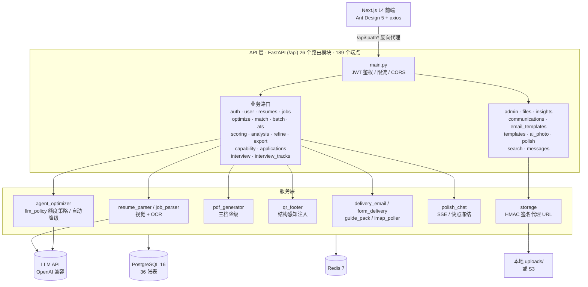
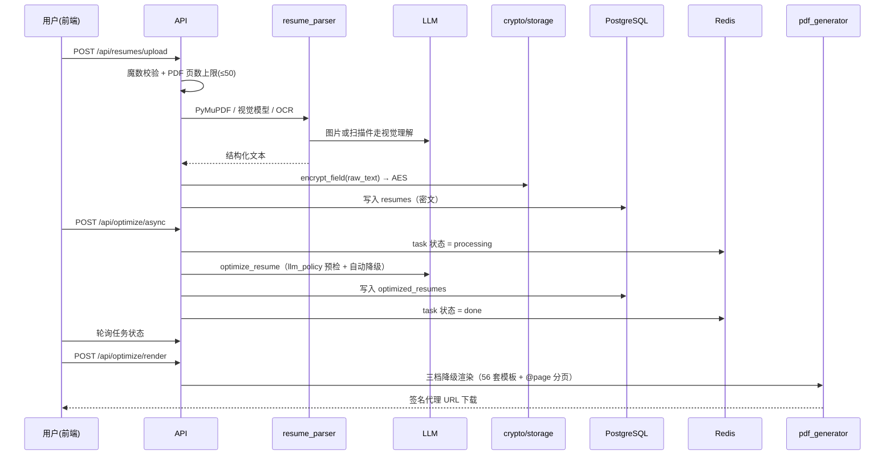

# 智能简历优化系统 · 项目概述 (Smart Resume)

> 上传简历 + 岗位需求 → AI 解析、匹配分析、逐段优化 → 渲染为专业排版的 PDF / Word。

面向求职者的 **SaaS 化简历优化平台**：除核心的「解析 → 优化 → 导出」链路外，还包含人岗匹配度评分
（匹配罗盘）、ATS 兼容性检测、岗位能力测评、面试押题与面试追踪、投递管理（邮件/表单/引导三通道）、
AI 对话润色、AI 职业照、二维码工具、56 套简历模板与可视化排版、批量优化、feedback 闭环，
以及配套的管理员后台、配额套餐与工单支持。

前后端分离，后端 FastAPI（Python 3.12），前端 Next.js 14（App Router + React 18 + Ant Design 5）。

> 想直接跑起来看效果？请阅读同目录的 **`README.md`（项目使用方法）**，本文只讲「系统是什么」。

---

## 核心能力

| 能力 | 入口模块 | 状态 |
| --- | --- | --- |
| 简历解析（PDF / 图片 / 文档 → 结构化文本） | `services/resume_parser.py` | 已接入（视觉模型 + PaddleOCR 兜底） |
| 简历智能优化 | `api/optimization.py` + `services/agent_optimizer.py` | 已接入 |
| 岗位 JD 解析（截图 / 文本） | `services/job_parser.py` | 已接入 |
| 人岗匹配度分析 / 匹配罗盘 | `api/matching.py` | 已接入（含未解析岗位具名提示 + 深链直达） |
| ATS 兼容性检测 | `api/ats.py` | 已接入 |
| 简历评分 / 岗位趋势 | `api/scoring.py` | 已接入 |
| 优化前后的规则聚合分析 | `api/analysis.py` | 已接入（纯规则，不消耗 AI 额度） |
| 面试押题（题目生成 / 收藏 / 笔记） | `api/interview.py` | 已接入 |
| 面试追踪（三 Tab 看板，独立于站内消息） | `api/interview_tracks.py` | 已接入 |
| 投递管理（邮件 / 表单 / 引导三通道） | `api/applications.py` + `services/delivery_email.py` `form_delivery.py` `guide_pack.py` | 已接入（email 通道 Redis 日额 20；**表单通道合规红线 = 无自动提交**） |
| 站内通信 / 邮件模板 | `api/communications.py` `api/email_templates.py` + `services/email_service.py` `imap_poller.py` `email_suppression.py` | 已接入 |
| 批量优化 | `api/batch.py` | 已接入 |
| AI 对话润色（编辑器内悬浮窗 PolishDock） | `api/polish.py` + `services/polish_chat.py` + `components/polish/PolishDock.tsx` | 已接入（SSE 流式、建议一键应用、**智能感知编辑器当前草稿**；独立 /polish 页已移除） |
| AI 职业照 | `api/ai_photo.py` + `services/ai_photo.py` | 已接入（Key 不落库、Redis 日额 20 失败退还） |
| 二维码工具（生成 + 简历页脚注入） | 前端 `/qrcode` + `services/qr_footer.py` | 已接入（结构感知注入：二维码紧跟正文内容列，不新增页） |
| 简历模板体系（56 套） | `api/templates.py` + `services/template_meta.py` + 前端 `lib/templates-register.tsx` | 已接入（前端唯一注册入口；pre-commit 校验三处同步） |
| 可视化排版（LayoutEditor） | 前端 `lib/layout/*` + `components/layout-editor/*` | 已接入（绝对定位 mm 坐标画布；二维码块与模板注入 1:1 双向回写） |
| Word / PDF 导出 | `api/export.py` + `services/docx_export.py` + `services/pdf_generator.py` | 已接入（渲染三档降级；`@page` 页边距为唯一事实源，改版式必跑 verify_wysiwyg） |
| 岗位能力测评（1~5 星自评 → 匹配度报告 + 补步建议 + 岗位排行） | `api/capability.py` + `services/capability_assessment.py` `capability_seed.py` | 已接入（20 个内置岗位画像） |
| 管理员后台（提示词 / 模型路由 / 关键词 / ATS 规则 / 工单 / 订单 / 配额） | `api/admin.py` | 已接入 |
| 模型路由与额度策略 | `services/model_resolver.py` + `core/llm_policy.py` | 已接入（优先 `model_routing` 表动态路由；`resolve_model` 按档位/到期自动降级，`check_before_call` 预检，403/401/400 不重试，`llm_errors` 中文报错） |
| CI | `.github/workflows/ci.yml` | 已接入（自包含 pytest） |

---

## 技术栈

### 后端

| 类别 | 选型 |
| --- | --- |
| Web 框架 / 服务器 | FastAPI + Uvicorn |
| ORM / DB 驱动 | SQLAlchemy 2.0（async）+ asyncpg |
| 数据库 | PostgreSQL 16（JSONB 承载半结构化字段） |
| 缓存 / 任务状态 / 限流 / 日额度 | Redis 7 |
| 鉴权 | JWT（HS256）双 Token（access + refresh，Max-Age 7 天） |
| 密码哈希 | bcrypt（passlib） |
| LLM SDK | `openai`（AsyncOpenAI，走 OpenAI 兼容协议） |
| PDF 渲染 | Playwright/Chromium → WeasyPrint → ReportLab（三档降级） |
| PDF 解析 / OCR | PyMuPDF；PaddleOCR（默认关闭） |
| 文档处理 | python-docx、pdf2docx、pylatex、Jinja2 |
| 字段加密 | AES-256-CBC（密钥派生自 `SECRET_KEY`） |
| 迁移 | Alembic |
| 异步任务 | 进程内 `asyncio.create_task` + Redis 状态轮询 + `task_recovery` 补偿（Celery 已声明未接入） |

### 前端

| 类别 | 选型 |
| --- | --- |
| 框架 | Next.js 14（App Router，`output: 'standalone'`） |
| UI / 语言 | Ant Design 5 + React 18 + TypeScript |
| 请求 | axios（统一封装于 `src/lib/api.ts`） |
| 图表 / 对比 | ECharts（echarts-for-react）、diff |
| 上传 | react-dropzone |
| 排版引擎 | 自研 `lib/layout/*`（mm 坐标画布、分页估算、溢出检测、HTML 渲染） |

### 大模型

- 接入方式：OpenAI 兼容协议（`base_url` + `api_key`）；文本/视觉/语音分档配置于 `backend/.env`。
- **额度策略（`core/llm_policy.py`）**：`resolve_model` 按用户档位与免费模型到期日自动降级；
  `check_before_call` 调用前预检（过期免费模型本地拦截，不发无效请求）；
  403/401/400 类错误不重试；`LLMQuotaExhausted` 在批处理链路上抛；错误码经 `llm_errors` 中文化。
- 改 `backend/.env` 模型清单（`FREE_QUOTA_MODELS`）后必须重启后端。
- **无有效 Key 时自动走 Mock 兜底**，可在无网环境联调 UI 与流程。

---

## 系统架构



### 关键架构决策

- **异步优先**：API 全面 async（SQLAlchemy async + asyncpg + `AsyncOpenAI`），不阻塞事件循环。
- **PII 保护**：后端**不挂载** `/uploads` 静态目录；文件只能通过 HMAC 签名代理 URL
  （`/api/files/{key}?exp=&sig=`）访问；`raw_text` 入库前 AES 加密；日志经脱敏过滤器。
- **自愈降级**：LLM 无 Key → Mock；PDF 渲染 Playwright → WeasyPrint → ReportLab。
- **进程内异步任务**：`/optimize/async` 用 `asyncio.create_task` + Redis 状态轮询 + `task_recovery` 补偿，未走 Celery。
- **模板单一事实源**：56 套模板在 `template_meta.py`（后端）、`app/templates/*.html`（Jinja）、
  `templates-register.tsx`（前端）三处登记，pre-commit 自动校验一致性（1757 项断言）。
- **投递合规红线**：表单通道只做预填引导（robots 从严 + 字段白名单），**绝无自动提交**。

---

## 项目结构

```
智能简历/
├── backend/                        # FastAPI 后端
│   ├── app/
│   │   ├── main.py                 # 入口：注册 26 个路由模块 + 日志脱敏 + create_all
│   │   ├── config.py               # Settings(BaseSettings)，env_file=".env"
│   │   ├── database.py             # engine / Base（async）
│   │   ├── api/                    # 路由层（26 个模块，189 个端点）
│   │   ├── models/                 # ORM 模型（36 张表）
│   │   ├── schemas/                # Pydantic 请求/响应模型
│   │   ├── services/               # 业务服务（解析 / 优化 / 渲染 / 投递 / 润色 / 二维码 / 模板…）
│   │   ├── core/                   # security · deps · crypto · errors · llm_policy · file_security · log_filter
│   │   └── prompts/                # LLM Prompt 模板
│   ├── tests/                      # pytest 173 项（tests/ 目录口径）
│   ├── alembic/                    # 迁移脚本
│   ├── run.py                      # 启动入口（处理 Windows ProactorEventLoop）
│   └── requirements.txt
├── frontend/                       # Next.js 14 前端
│   └── src/
│       ├── lib/api.ts              # axios 客户端 + 全部接口封装
│       ├── lib/templates-register.tsx  # 56 套模板前端唯一注册入口
│       ├── lib/layout/             # 可视化排版引擎（buildLayout / renderHtml / paging / estimate…）
│       ├── app/                    # 31 个页面（/ · /resumes · /jobs · /match · /batch · /ats
│       │                           #   /scoring · /interview · /interviews · /applications
│       │                           #   /capability · /qrcode · /photo · /history/[id]
│       │                           #   /templates · /messages · /recycle · /admin …）
│       ├── components/             # 通用组件 + optimize/ + ios/ + layout-editor/ + polish/PolishDock
│       └── types/                  # TypeScript 类型
├── scripts/                        # 49 个 verify_*.py E2E / 守护脚本（pytest 之外的回归基线）
├── docker/
│   ├── docker-compose.yml          # db / redis / backend / frontend
│   └── nginx.conf
├── docs/                           # 19 篇交付/部署/合规文档（含 jadeAI 移植、LLM 降级修复、鉴权门修复等）
├── public.sql                      # 数据库建表 SQL
├── 补充测试数据.sql / 管理后台测试数据.sql 等演示数据
├── stop_all.bat
└── README.md
```

---

## 核心流程

### 上传 → 解析 → 优化 → 渲染



### AI 润色悬浮窗（编辑器内）

用户在 `/history/{id}` 编辑器中打开 PolishDock → 每次发消息携带**当前草稿**（含未保存修改）→
`/api/polish/chat` 刷新会话上下文快照 → SSE 流式回复 + 改写建议卡片 → 点「应用」写回编辑器草稿
（编辑态）或直接落库并重导出 PDF（查看态）。旧独立 `/polish` 页已移除。

### 投递三通道

`/applications` 以 `job_image_id` 为粒度（UniqueConstraint 防重，409）：
**email**（后端投递，Redis 日额 20，dry-run 也计数）、**form**（预填引导，无自动提交）、
**guide**（深链引导，末步用户手动）。`imap_poller` 轮询收件箱回捞回复，`delivery_event` 记录状态机。

### 鉴权（双 Token）

邮箱/密码 + 验证码注册 → 登录签发 `access` + `refresh`(7d) → Bearer 访问业务接口 →
middleware 只判 cookie 有无票 → 前端 AuthGatekeeper 全局门 + 单飞静默刷新（`docs/鉴权门与静默刷新修复说明.md`）。

> 注：登录成功后的落地页为「首页」`/dashboard`（而非「优化」页 `/`）。演示账号 `demo@smart-resume.com / Demo@123456`。

---

## 数据模型

共 **36 张表**（ORM 模型）；字段定义以 `public.sql` 为准。

| 域 | 表 |
| --- | --- |
| 账户 | `users` `user_devices` `admins` `verification_codes` `user_quotas` |
| 简历与岗位 | `resumes`（`raw_text` 密文） `optimized_resumes` `job_images` `resume_templates` |
| 优化与任务 | `batch_optimizations` `batch_job_tasks` `feedbacks` |
| 润色 | `polish_sessions` `polish_messages` |
| 投递 | `applications` `delivery_events` |
| 面试 | `interview_sessions` `interview_questions` `interview_tracks` |
| 能力测评 | `capability_assessments` |
| 通信 | `communications` `email_templates` `email_suppressions` |
| 运营 | `orders` `quota_packages` `support_tickets` `ticket_replies` `messages` |
| 配置 | `model_routing`（已接入） `prompt_templates`（管理后台可配） `ats_rules` `industry_keywords` |
| 审计 | `audit_logs` `admin_logs` `ai_model_call_logs` |

主要关系：`users` 1—N `resumes` / `user_devices` / `user_quotas` / `audit_logs`；
`resumes` 1—N `optimized_resumes`；`batch_optimizations` 1—N `batch_job_tasks`；
`job_images` 1—1 `applications`（防重投递）；`polish_sessions` 1—N `polish_messages`。

---

## API 概览

统一前缀 `/api`，鉴权接口一律 Bearer access token。26 个路由模块、约 **189 个端点**，注册见 `backend/app/main.py`。

| 前缀 | 代表端点 | 说明 |
| --- | --- | --- |
| `/api/auth` | `POST /register` `POST /login` `POST /refresh` `GET /devices` | 注册 / 登录 / 双 Token / 设备管理 |
| `/api/user` | `GET /profile` `PUT /profile` `POST /avatar` `GET /export-data` | 个人资料 |
| `/api/resumes` | `POST /upload` `GET /stats` `GET /trash` `POST /batch-delete` | 简历 CRUD / 收藏 / 回收站 |
| `/api/jobs` | `POST /upload` `GET /categories` `PUT /{id}/primary` | 岗位 JD 管理与解析 |
| `/api/optimize` | `POST /` `POST /quick` `GET /diff` `POST /render` `save` `export-layout` | 优化核心链路 + 排版画布回写 |
| `/api/match` | `POST /` `POST /rank` | 人岗匹配度（rank 含 `skipped_items` 未解析岗位明细） |
| `/api/applications` | `POST /` `POST /{id}/withdraw` | 投递管理（三通道，防重 409） |
| `/api/interview-tracks` | — | 面试追踪看板 |
| `/api/communications` · `/api/email-templates` | — | 站内通信 / 邮件模板 |
| `/api/analysis` | `POST /resume` | 规则型聚合分析，不耗 AI 额度 |
| `/api/batch-optimize` · `/api/batch/{id}/status` | — | 批量优化 |
| `/api/ats` | `POST /check` | ATS 兼容性检测 |
| `/api/resume/{id}/score` · `/api/jobs/trending` | — | 评分与趋势 |
| `/api/optimization/{id}/refine` | — | 精炼改写 |
| `/api/interview` | `POST /generate` `GET /sessions` `GET /bookmarks` | 面试押题 |
| `/api/capability` | `GET /jobs` `POST /jobs/{id}/assessments` `GET /ranking` | 岗位能力测评 |
| `/api/templates` | — | 56 套简历模板（元数据 / 预览） |
| `/api/ai-photo` | `POST /generate` | AI 职业照 |
| `/api/polish` | `POST /sessions` `POST /chat`(SSE) `GET /sessions` | AI 对话润色（chat 支持携带编辑器草稿 context） |
| `/api/export` | `GET /optimize/{id}/docx` `GET /resume/{id}/docx` | Word 导出 |
| `/api/insights` | `GET /overview` | 数据洞察 |
| `/api/search` | `GET ""` | 站内搜索 |
| `/api/feedback` | `POST /` `GET /stats` | 反馈闭环 |
| `/api/messages` | `GET ""` `PUT /read-all` | 站内消息 |
| `/api/files/{key}` | — | HMAC 签名代理下载 |
| `/api/admin` | `POST /login` `GET /users` `POST /templates` … | 管理后台 |

> 错误码统一由 `core/errors.py` 的 `app_err(code)` 返回中文码，
> 如 `RESUME_NOT_FOUND`、`FILE_TOO_LARGE`、`PARSE_BEFORE_OPTIMIZE`、`QUOTA_EXCEEDED`；
> LLM 类错误经 `core/llm_errors.py` 中文化（额度耗尽 / 模型过期等）。

---

## 质量基线

| 项 | 口径 | 现状 |
| --- | --- | --- |
| 后端 pytest | `backend/` 下 `pytest tests/`（勿全仓收集，根目录历史 debug 文件会假失败） | **173/173** |
| 前端单测 | `frontend/` 下 `node --test`（非 vitest） | **410/410** |
| 模板同步守护 | pre-commit 自动跑 `check_template_sync` | 1757/1757 |
| PDF 版式守护 | 改版式必跑 `verify_wysiwyg.py` + `verify_all_templates` | 39/39 + 224/224 |
| E2E 脚本 | `scripts/verify_*.py` 共 49 个（登录态注入用 add_init_script + cookie） | 按需运行 |
| TypeScript | `npx tsc --noEmit` | 0 错误 |

---

## 已知限制与技术债

| # | 项 | 现状 | 影响 |
| --- | --- | --- | --- |
| 1 | 提示词模板未入业务链路 | `prompt_templates` 管理后台可配置，但优化链路仍用内置 `prompts/` | 管理员在线调提示词不即时生效 |
| 2 | Celery 被绕过 | 改用 `asyncio.create_task` + `task_recovery` 补偿 | 进程重启丢任务面收窄，仍无分布式队列 |
| 3 | 可观测性仅日志 | 无 metrics / tracing / alerting | 生产排障困难 |
| 4 | 删除账户无自动清理 | 30 天冻结 + Celery 未启用 | 冻结数据可能永不清理 |
| 5 | 测试需本地依赖 | CI 仅跑自包含 pytest；完整回归需本机 DB / Redis / Playwright | 部分用例（49 个 E2E 守护）未纳入 CI |
| 6 | 部分历史文档过时 | 根目录诊断类文档为旧版结论 | 以 `docs/` 交付文档与代码为准 |

> 已解决：~~模型路由未接入~~（现 `model_resolver` 优先 `model_routing` 表动态路由，`llm_policy` 自动降级 + 预检）。

---

_本概述依据当前代码实测整理（2026-11-03）；代码为唯一事实来源，如有冲突以代码为准。_
