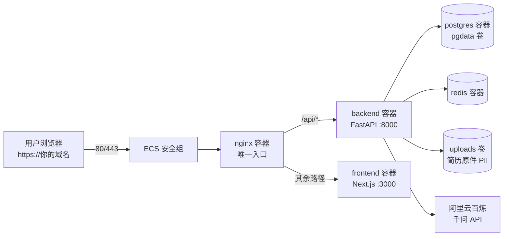

# 阿里云 ECS 部署指南 · 智能简历优化系统

> 目标：把本项目部署到阿里云 ECS，供他人通过浏览器访问；PostgreSQL / Redis / 上传文件全部持久化。
> 方案：**Docker Compose 一键编排**——项目 `docker/docker-compose.yml` 已按「ECS 生产」写好，nginx 是唯一对外入口。

> ⚠️ **实例是 Windows Server？** 本指南所有命令按 Linux 编写。Docker Desktop 官方不支持 Windows Server，硬上只能 WSL2 手动装 Docker Engine，坑多且不适合生产；实例无重要数据时最省事的是重装为 Alibaba Cloud Linux 3（控制台约 5 分钟，顺带免掉 Windows 授权费），步骤见 `docs/极简部署教程.md` 第 0 步。只想看最简流程的，直接读那份文档。

---

## 0. 部署架构总览



| 组件 | 容器 | 对外暴露 | 说明 |
| --- | --- | --- | --- |
| nginx | `nginx` | **80 / 443** | 唯一入口，`/api/` 反代后端，其余反代前端 |
| 后端 | `backend` | ❌ 仅容器网络 | FastAPI，`/health` 健康检查 |
| 前端 | `frontend` | ❌ 仅容器网络 | Next.js standalone |
| 数据库 | `db` | ❌ 仅容器网络 | PostgreSQL 16，数据落 `pgdata` 卷 |
| 缓存 | `redis` | ❌ 仅容器网络 | 限流 / 任务状态，**不可用时部分接口报错** |
| celery_worker | `celery_worker` | ❌ | 业务代码未接入 Celery，**默认不启动，省资源** |

两个 Docker 卷承载全部持久化数据：`pgdata`（数据库）、`uploads`（上传的简历文件，仅经后端签名 URL 下发，不做公开静态目录）。

---

## 1. ECS 准备

### 1.1 选购建议

| 项 | 最低（跑起来） | 推荐（多人使用） |
| --- | --- | --- |
| 规格 | 2 vCPU / 4 GiB | 4 vCPU / 8 GiB |
| 系统 | Alibaba Cloud Linux 3.2104 LTS 或 Ubuntu 22.04 64 位 | 同左 |
| 系统盘 | 40 GiB ESSD（默认即可） | 40~100 GiB ESSD |
| 带宽 | 按固定带宽 3 Mbps | 按固定带宽 5 Mbps |
| 地域 | 靠近用户；**大陆地域域名需备案** | 同左 |

> PDF 导出走 Playwright/Chromium → WeasyPrint 降级链，渲染时吃内存，4 GiB 是多人并发底线。

### 1.2 安全组（阿里云控制台 → ECS → 网络与安全 → 安全组 → 配置规则）

| 方向 | 端口 | 授权对象 | 用途 |
| --- | --- | --- | --- |
| 入方向 | 22 | **仅自己的 IP**（不要 0.0.0.0/0） | SSH 管理 |
| 入方向 | 80 | 0.0.0.0/0 | HTTP |
| 入方向 | 443 | 0.0.0.0/0 | HTTPS（配好证书后开） |

出方向保持默认全放通（容器拉镜像、后端调百炼 API 都需要）。

### 1.3 域名（推荐，IP 直连也可先用）

- 域名解析 A 记录 → ECS **公网 IP**。
- **大陆地域 ECS + 域名访问 80/443 必须 ICP 备案**（约 1~2 周，阿里云备案系统操作）；未备案可先用 `http://公网IP` 验证，或选中国香港地域（免备案，但国内访问延迟略高）。

---

## 2. 服务器初始化：安装 Docker

SSH 登录（`ssh root@你的公网IP`）后按系统选择：

<details>
<summary><b>Alibaba Cloud Linux 3（默认推荐）</b></summary>

```bash
dnf config-manager --add-repo https://mirrors.aliyun.com/docker-ce/linux/centos/docker-ce.repo
dnf install -y docker-ce docker-ce-cli containerd.io docker-compose-plugin
systemctl enable --now docker
docker version && docker compose version
```
</details>

<details>
<summary><b>Ubuntu 22.04</b></summary>

```bash
apt-get update
apt-get install -y ca-certificates curl gnupg
install -m 0755 -d /etc/apt/keyrings
curl -fsSL https://mirrors.aliyun.com/docker-ce/linux/ubuntu/gpg -o /etc/apt/keyrings/docker.asc
echo "deb [arch=amd64 signed-by=/etc/apt/keyrings/docker.asc] https://mirrors.aliyun.com/docker-ce/linux/ubuntu $(lsb_release -cs) stable" > /etc/apt/sources.list.d/docker.list
apt-get update
apt-get install -y docker-ce docker-ce-cli containerd.io docker-compose-plugin
docker version && docker compose version
```
</details>

**可选：镜像加速**（拉取 postgres/redis/node 等镜像更快）。编辑 `/etc/docker/daemon.json`：

```json
{ "registry-mirrors": ["https://<你的加速地址>.mirror.aliyuncs.com"] }
```

加速地址在 阿里云控制台 → 容器镜像服务 ACR → 镜像加速器 获取（个人版免费）。保存后 `systemctl restart docker`。

---

## 3. 上传项目代码

### 方式 A：本地打包 + scp（推荐，无需 GitHub）

在**本地 Windows Git Bash**执行（排除体积大的目录）：

```bash
cd /d/Desktop/智能简历1
tar --exclude=frontend/node_modules --exclude=frontend/.next \
    --exclude=backend/.venv --exclude='__pycache__' --exclude=.git \
    -czf smart-resume.tar.gz .
scp smart-resume.tar.gz root@你的公网IP:/opt/
```

服务器上解压：

```bash
mkdir -p /opt/smart-resume
tar -xzf /opt/smart-resume.tar.gz -C /opt/smart-resume
cd /opt/smart-resume
```

> 这种方式会把本地的 LLM 计费守卫文件（`backend/app/core/llm_policy.py`、`llm_call_log.py` 等）一起带上去，服务器上同样生效，能防止误调付费模型。

### 方式 B：git clone

先把仓库推到 GitHub/GitCode，再 `git clone`。
⚠️ **`backend/.env`（含 LLM API Key）绝不能进公开仓库**——推送前确认 `git status` 干净、`.env` 在 `.gitignore` 中。方式 B 不会带上本地计费守卫文件，需要另行拷贝。

---

## 4. 配置环境变量（最关键的一步）

### 4.1 compose 级配置 `docker/.env`

```bash
cd /opt/smart-resume
cp docker/.env.production.example docker/.env
```

按注释修改两项（模板文件已带逐行说明）：

| 变量 | 填什么 |
| --- | --- |
| `POSTGRES_PASSWORD` | 自设强密码（决定容器内数据库密码，全程不暴露公网） |
| `NEXT_PUBLIC_API_URL` | **浏览器可达的后端地址**，如 `https://你的域名`（经 nginx 同域反代） |

> ⚠️ `NEXT_PUBLIC_API_URL` 是前端**构建期**内联变量，以后改域名必须重新构建前端：
> `docker compose --env-file docker/.env -f docker/docker-compose.yml up -d --build frontend`

### 4.2 应用级配置 `backend/.env`

```bash
cd /opt/smart-resume
cp backend/.env.example backend/.env
chmod 600 backend/.env
```

必须修改的项：

| 变量 | 操作 |
| --- | --- |
| `SECRET_KEY` | 重新生成：`python3 -c "import secrets;print(secrets.token_urlsafe(48))` 后粘贴。**服务器是全新库，直接换新值即可**（若要从本地迁已有数据，见第 9.4 节） |
| `LLM_API_KEY` | 你的千问/百炼 API Key（文本与视觉共用） |
| `CORS_ORIGINS` | `https://你的域名`（同域反代下其实不会触发跨域，填上双保险） |
| `BACKEND_URL` | `https://你的域名`（签名下载 URL 的域名，填错会导致文件下载链接不可达） |
| `LLM_MODEL_TEXT` / `LLM_MODEL_VISION` | 与本地 `.env` 保持一致即可（本地已按百炼免费额度到期时间调过；到期模型转按量计费，可用 `backend/check_llm_policy.py` 体检） |

### 4.3 🔴 SMTP：公网给他人用必须配置

注册流程强制邮箱验证码（`backend/app/api/auth.py:50` 校验 `verification_codes` 表；`backend/app/services/email_service.py:26-28`：未配 SMTP 时验证码只打印到后端日志）。

| 场景 | 要不要配 SMTP |
| --- | --- |
| 自己调试 / 演示 | 不配，验证码在 `docker compose ... logs backend` 里看 |
| **开放给他人注册** | **必须配**，否则每个用户都要你登服务器翻日志告知验证码 |

QQ 邮箱配置（`.env` 里 5 项）：

```ini
SMTP_HOST=smtp.qq.com
SMTP_PORT=587
SMTP_USER=你的邮箱@qq.com
SMTP_PASSWORD=授权码（QQ邮箱 设置→账户 开启POP3/SMTP后生成，不是QQ密码）
SMTP_FROM=你的邮箱@qq.com
```

配好后用 `/api/auth/send-code` 发一封实测：`docker compose --env-file docker/.env -f docker/docker-compose.yml logs backend | grep 邮件`。

---

## 5. 构建与启动

在 `/opt/smart-resume` 下执行：

```bash
docker compose --env-file docker/.env -f docker/docker-compose.yml up -d --build
```

说明：

1. **首次构建 10~30 分钟**（后端 pip 安装约 300+ MB、前端 npm install、拉取 postgres/redis/nginx 镜像），耐心等 `docker compose ... ps` 全部 `Up`。
2. 命令**不含 celery_worker**（业务未接入，省 ~1 台容器的内存）。
3. 启动顺序由 `depends_on + healthcheck` 保证：db / redis 健康后才起 backend。
4. **表结构自动创建**：backend 首次启动时 `lifespan` 执行 `Base.metadata.create_all`（约 26 张表）+ 岗位画像播种（`backend/app/main.py:23-32`），无需手动导 `public.sql`。
5. 国内服务器若嫌 pip / npm 慢，可分别给 `backend/Dockerfile` 的 pip 行加 `-i https://pypi.tuna.tsinghua.edu.cn/simple`、`frontend/Dockerfile` 的 npm 行加 `--registry=https://registry.npmmirror.com`（改完需重新 build）。

健康检查：

```bash
curl http://127.0.0.1/health        # 经 nginx 反代到 backend
# 期望：{"status":"ok",...}
```

### 5.1 （可选）安装 Playwright Chromium

PDF 导出三档降级：Playwright/Chromium → WeasyPrint → ReportLab。后端镜像**默认不带 Chromium**（`backend/Dockerfile` 只装了系统库），会自动降到 WeasyPrint（镜像里已有 libpango，可用，模板保真度略低）。想要最高保真度：

```bash
# 立即生效（写在容器可写层，重建镜像后丢失）
docker compose --env-file docker/.env -f docker/docker-compose.yml exec backend \
  python -m playwright install chromium
```

永久生效：在 `backend/Dockerfile` 的 `RUN pip install` 之后加一行再重新 build：

```dockerfile
RUN python -m playwright install --with-deps chromium
```

---

## 6. 导入演示数据（可选，用于展示/验收）

面向真实用户可跳过本节（用户自行注册）。要演示账号则按序执行：

```bash
cd /opt/smart-resume
COMPOSE="docker compose --env-file docker/.env -f docker/docker-compose.yml"

# 1) 等 backend 起来（表已自动建好）
$COMPOSE ps

# 2) 创建超管（演示数据工单表的外键依赖它；幂等）
$COMPOSE exec -T db psql -U postgres -d smart_resume <<'SQL'
INSERT INTO admins (id, username, password_hash, role, email, is_active)
VALUES ('f060f9c2-2ca4-4f83-9fb1-c2bfa7c9233e', 'superadmin',
        '$2b$12$i8bfWcMmFH5X1P3QAZmfle8qR0toc6rRBTGd/gtFSYINVyacqU5re',
        'super_admin', 'admin@example.com', true)
ON CONFLICT (id) DO NOTHING;
SQL

# 3) 导入演示数据（PGCLIENTENCODING 防中文乱码；幂等，可重跑）
PGCLIENTENCODING=UTF8 $COMPOSE exec -T db psql -U postgres -d smart_resume < 演示测试数据.sql
```

可用账号：

| 角色 | 账号 | 密码 |
| --- | --- | --- |
| 演示用户 | `demo@smart-resume.com` | `Demo@123456` |
| 超管（管理后台） | `superadmin` | `admin123` |

> ⚠️ 演示账号是公开的，开放注册前想清楚是否保留；不需要时用 `演示测试数据-清理.sql` 同样方式导入清理。

---

## 7. 验证部署

```bash
curl http://你的公网IP/health                                   # 后端经 nginx 存活
curl -X POST http://你的公网IP/api/auth/send-code \
  -H "Content-Type: application/json" \
  -d '{"email":"你的邮箱@qq.com","purpose":"register"}'         # 收到邮件=SMTP 通
```

浏览器打开 `http://你的公网IP`（或域名）→ 注册 → 登录 → 上传简历 + 岗位 → 走一遍「解析 → 优化 → 导出 PDF」。PDF 能下载即 `uploads` 卷与签名 URL 正常。

---

## 8. 域名 + HTTPS（推荐）

1. **申请证书**：阿里云控制台 → 数字证书管理服务 → SSL 证书 → 免费证书（个人版，单域名，**3 个月有效期，到期手动续期**）→ 选「Nginx」下载，得到 `.pem`（证书链）和 `.key`（私钥）。
2. **放到服务器**：上传到 `/opt/smart-resume/docker/certs/`，按 `docker/nginx-https.conf` 里的文件名对应修改。
3. **切换 nginx 配置**：

```bash
cd /opt/smart-resume
cp docker/nginx.conf docker/nginx.http.bak      # 备份原配置
cp docker/nginx-https.conf docker/nginx.conf    # 使用 HTTPS 版（含 80 跳转）
```

4. **compose 开放 443 并挂证书**：编辑 `docker/docker-compose.yml` 的 nginx 服务：

```yaml
  nginx:
    ports:
      - "80:80"
      - "443:443"
    volumes:
      - ./nginx.conf:/etc/nginx/conf.d/default.conf:ro
      - ./certs:/etc/nginx/certs:ro
```

5. **重建 nginx 并同步改 `.env`**：把 `docker/.env` 的 `NEXT_PUBLIC_API_URL` 和 `backend/.env` 的 `CORS_ORIGINS` / `BACKEND_URL` 都改成 `https://你的域名`，然后：

```bash
docker compose --env-file docker/.env -f docker/docker-compose.yml up -d --build
```

（前端因 `NEXT_PUBLIC_API_URL` 变更必须一起重建，上面命令已覆盖。）

6. 安全组放行 443，访问 `https://你的域名` 验证；证书到期前在阿里云续期后替换 `docker/certs/` 文件并 `docker compose ... restart nginx`。

---

## 9. 数据持久化与备份

### 9.1 数据在哪

```bash
docker volume ls                                    # 看到 smart-resume_pgdata / smart-resume_uploads
docker volume inspect smart-resume_pgdata           # 宿主机实际路径（默认 /var/lib/docker/volumes/...）
```

### 9.2 自动备份数据库（已备好脚本）

```bash
cd /opt/smart-resume
mkdir -p logs
bash scripts/backup_db.sh          # 立即产出一份 backups/smart_resume_YYYYMMDD_HHMMSS.sql.gz

# 加定时任务：每天凌晨 3 点
(crontab -l 2>/dev/null; echo "0 3 * * * cd /opt/smart-resume && bash scripts/backup_db.sh >> logs/backup.log 2>&1") | crontab -
```

默认保留最近 7 份，可用 `KEEP=30 bash scripts/backup_db.sh` 调整。

### 9.3 备份上传文件

`uploads` 卷同样要备份（简历原件属于 PII，注意保管）：

```bash
tar -czf backups/uploads_$(date +%Y%m%d).tar.gz -C /var/lib/docker/volumes/smart-resume_uploads/_data .
```

### 9.4 恢复

```bash
gunzip -c backups/smart_resume_20261019_030000.sql.gz | \
  docker compose --env-file docker/.env -f docker/docker-compose.yml exec -T db \
  psql -U postgres -d smart_resume
```

> 从本地迁已有数据到服务器：先在本地用旧 `SECRET_KEY` 解密导出，再 `pg_dump` 导入；直接换 `SECRET_KEY` 会导致历史 `raw_text` 密文无法解密（`backend/app/core/crypto.py` 的 AES 密钥派生自 `SECRET_KEY`）。

---

## 10. 可选升级（用户量上来后再做）

| 升级项 | 做法 |
| --- | --- |
| **RDS PostgreSQL** | 买 RDS PostgreSQL 16 → 白名单加 ECS 内网 IP → 把 `docker-compose.yml` 中 backend 的 `DATABASE_URL` 改为 `postgresql+asyncpg://用户:密码@RDS内网地址:5432/smart_resume` → 去掉 `db` 服务与 `pgdata` 卷。RDS 自带备份，可删掉 `backup_db.sh` |
| **云数据库 Redis** | 买 Redis 云实例 → backend `REDIS_URL` 改为 `redis://:密码@内网地址:6379/0` → 去掉 compose 的 `redis` 服务 |
| **OSS 对象存储** | `backend/app/services/storage.py:78-99` 通过 boto3 支持 S3 兼容服务：设 `AWS_ACCESS_KEY_ID` / `AWS_SECRET_ACCESS_KEY`（RAM 用户 AK）/ `S3_BUCKET` / `S3_REGION` / `S3_ENDPOINT=https://oss-cn-hangzhou.aliyuncs.com`。⚠️ 上传返回的 URL 目前按 AWS 风格硬编码拼接（`storage.py:99`），用于 OSS 需把该行改成你的 OSS 域名；下载仍走后端签名代理，不受影响 |

---

## 11. 日常运维命令

```bash
cd /opt/smart-resume
COMPOSE="docker compose --env-file docker/.env -f docker/docker-compose.yml"

$COMPOSE ps                                    # 看状态
$COMPOSE logs -f backend                       # 后端实时日志（验证码、报错都在这）
$COMPOSE logs --tail=100 frontend              # 前端最近日志
$COMPOSE restart backend                       # 重启单个服务
$COMPOSE down                                  # 全停（卷与数据保留）
$COMPOSE up -d --build                         # 更新代码后重新构建并启动
$COMPOSE exec backend bash                     # 进后端容器
$COMPOSE exec db psql -U postgres smart_resume # 进数据库
```

**更新部署**：本地打包上传（tar 命令见「极简部署教程」第 4 步，排除 `.env`）→ 服务器上 `bash scripts/update_server.sh`（自动备份数据库 → 存回滚点 `/root/rollback/` → 覆盖代码 → 按需 rebuild → 健康检查）。只改后端可指定服务跳过前端构建：`bash scripts/update_server.sh /root/app.tar.gz backend celery_worker`。
**回滚**：更新失败时按脚本输出的命令回滚；或手动 `cd /opt && rm -rf smart-resume && tar -xzf /root/rollback/code_<时间戳>.tar.gz -C /opt && cd smart-resume && docker compose --env-file docker/.env -f docker/docker-compose.yml up -d --build`。uploads 卷与 pgdata 卷不受回滚影响。

---

## 12. 费用估算（参考价，以阿里云实时价格为准）

| 项目 | 配置 | 月费用（约） |
| --- | --- | --- |
| ECS | 2C4G3M 包年（新用户/活动价常见） | ¥60~150 |
| ECS | 4C8G5M 包年 | ¥200~400 |
| 系统盘 | 40 GiB ESSD | 已含在实例 |
| SSL 证书 | 免费个人证书 | ¥0 |
| 百炼 LLM | 按 token 计费（注意免费额度 90 天有效期） | 按实际用量 |
| RDS / 云 Redis | 后期升级才需要 | ¥50~200 起 |

---

## 13. 排障 FAQ

| 现象 | 原因与处理 |
| --- | --- |
| 访问 IP 超时 | 安全组没放行 80；或 ECS 没公网 IP；`curl 127.0.0.1/health` 能通则查安全组 |
| 502 Bad Gateway | backend/frontend 没起来：`$COMPOSE ps` 看状态，`$COMPOSE logs backend` 看报错 |
| 注册收不到验证码 | SMTP 没配或授权码错；`$COMPOSE logs backend \| grep -i 邮件` 看「模拟邮件」或发送失败原因 |
| 登录 500 / bcrypt 报错 | 确认 `requirements.txt` 里 `bcrypt<5`（passlib 1.7.4 不兼容 bcrypt 5） |
| PDF 导出失败或样式丢 | Chromium 未装走 WeasyPrint 降级；按 5.1 节安装；仍失败看 `$COMPOSE logs backend` |
| 数据库连接失败 | 改过 `POSTGRES_PASSWORD` 但没重建 backend（compose 的 environment 会覆盖 `.env` 的 `DATABASE_URL`，改 `docker/.env` 后需 `up -d` 重建 backend） |
| 接口间歇报「限流」错误 | Redis 挂了；限流器依赖 Redis，`$COMPOSE ps` 确认 redis 在跑 |
| 内存不足 OOM | 升到 4C8G；或确认没起 celery_worker；`docker stats` 看各容器占用 |
| 改域名后前端还请求旧地址 | `NEXT_PUBLIC_API_URL` 是构建期变量，必须 `up -d --build frontend` |
| 上传 20MB 以上失败 | `MAX_UPLOAD_SIZE`（默认 20MB）与 nginx `client_max_body_size`（50M）调大 |

---

## 14. 同机托管静态站点（服务器上已有静态项目）

> ⚠️ **重装系统会清空系统盘**：静态项目文件必须先备份到本地再重装。
> 备份方式：安全组临时开放 3389（仅自己 IP）→ 本地 `mstsc` 远程桌面把站点目录拷出来 → **立刻删掉 3389 规则**；或项目在 git 里就直接 `git clone`。IIS 默认站点根目录一般是 `C:\inetpub\wwwroot`。
> 不建议「Windows  IIS 继续跑静态站 + SmartResume 单独上 Docker」——Docker Desktop 不支持 Windows Server，两套体系共存运维成本极高，建议一起搬到 Linux。

部署 SmartResume 后，静态站与它共用同一个 nginx（80 端口不冲突），二选一：

### 方式一：子路径 `/site/`（无域名时最省事）

1. 静态文件放到服务器 `/opt/smart-resume/static-site/`（入口为 `index.html`）
2. `docker/docker-compose.yml` 的 nginx 服务 volumes 加一行：

```yaml
    volumes:
      - ./nginx.conf:/etc/nginx/conf.d/default.conf:ro
      - ./static-site:/usr/share/nginx/html/site:ro
```

3. `docker/nginx.conf`（启用 HTTPS 后是 `docker/nginx-https.conf`）的 server 块里加：

```nginx
    location = /site { return 301 /site/; }
    location /site/ {
        root /usr/share/nginx/html;
        index index.html;
        try_files $uri $uri/ /site/index.html;
    }
```

4. 重建 nginx：

```bash
docker compose --env-file docker/.env -f docker/docker-compose.yml up -d
```

访问：应用在 `http://域名或IP/`，静态站在 `http://域名或IP/site/`（`/` 归前端、`/api/` 归后端、`/site/` 归静态站，互不抢占）。

### 方式二：独立域名 / 子域名（有域名和证书时）

在 `docker/nginx-https.conf` 追加一个 server 块（80 的跳转规则已自动覆盖它，无需改 80 块）：

```nginx
server {
    listen 443 ssl;
    server_name static.你的域名;
    ssl_certificate     /etc/nginx/certs/static.你的域名.pem;
    ssl_certificate_key /etc/nginx/certs/static.你的域名.key;
    root /usr/share/nginx/html/site;
    index index.html;
    location / { try_files $uri $uri/ /index.html; }
}
```

同样需要 compose 挂载 `./static-site`，然后 `up -d` 重建 nginx。

---

_本指南依据项目当前代码与 `docker/docker-compose.yml` 实测整理；代码为唯一事实来源。_
